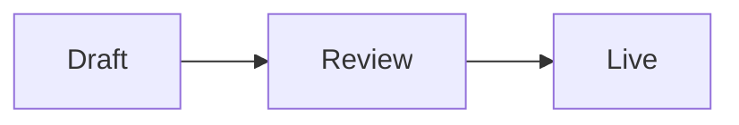

Posts are Markdown plus a small set of extensions. Standard GFM works everywhere: headings, lists, tables, task lists, strikethrough, links, images, and footnotes. Everything below renders on the public blog. Agents receive the same guide from `posts.format_guide`.

## Callouts

GitHub-style alerts render as callout cards. The kinds are `NOTE`, `TIP`, `IMPORTANT`, `WARNING`, and `CAUTION` (letter case does not matter). The directive syntax accepts the same kinds plus `info`, `success`, `danger`, and `error` as aliases — the alerts do not.

```md
> [!WARNING]
> This action changes your configuration.
```

A directive callout adds a custom title:

```md
:::tip[Start small]
Give your first agent the draft scope only.
:::
```

## Collapsible section

```md
:::details[Why not auto-publish?]
Hidden until the reader expands it.
:::
```

## Code

Always label the language. Fences take a title, highlighted line ranges, line numbers, and `wrap`:

```ts title="src/publish.ts" {2} showLineNumbers
const tip = await cms.posts.get(id)
return cms.posts.publish(id)
```

Line markers highlight or diff-mark lines and are stripped from the output: `// [!code ++]`, `// [!code --]`, `// [!code highlight:2]`, `// [!code word:x]`. Inline code can carry a language: `` `fetch(url){:ts}` ``.

A `code-group` directive shows fenced blocks as tabs, named by `title` or `[label]`:

````md
:::code-group
```ts [a.ts]
...
```
```js [a.js]
...
```
:::
````

## Tabs and steps

Tabs label alternatives and sync the reader's choice across the page by label:

```md
::::tabs
:::tab[macOS]
Press Cmd+K.
:::
:::tab[Windows]
Press Ctrl+K.
:::
::::
```

Steps number a list or headings:

```md
:::steps
1. Install the CLI.
2. Run `vibecms login`.
:::
```

## Images

An image's title, or an italic line directly below it (no blank line), becomes a caption:

```md

```

`#gh-light-mode-only` and `#gh-dark-mode-only` on the URL show the image only in that color scheme.

## Math and diagrams

KaTeX math uses `$$` for display blocks, `$$...$$` inline, or a `math` fence. A single `$` stays literal, so prices are safe. A `mermaid` fence (up to 5,000 characters) draws a diagram; readers without JavaScript see the source.

````md
$$\int_0^1 x^2\,dx = \frac{1}{3}$$


````

## Headings and table of contents

`{#id}` sets a stable anchor (lowercase letters, digits, hyphens; rendered as `#h-<id>`), and `[!toc]` keeps a heading out of the table of contents:

```md
## Install {#install}
## Aside [!toc]
```

`[[toc]]` places an inline table of contents. A page-level outline can also be set per post through the editor or `presentation.toc` — prefer one or the other, not both.

## Embeds and HTML

A bare YouTube link on its own line becomes a video card. Footnotes follow GFM: `Text.[^1]` plus `[^1]: Note.`

A small set of GitHub-safe inline HTML is allowed — `<kbd>`, `<sub>`, `<sup>`, and similar. Scripts, iframes, styles, and unknown tags are removed and reported as warnings by the editor and `posts.preview`.
